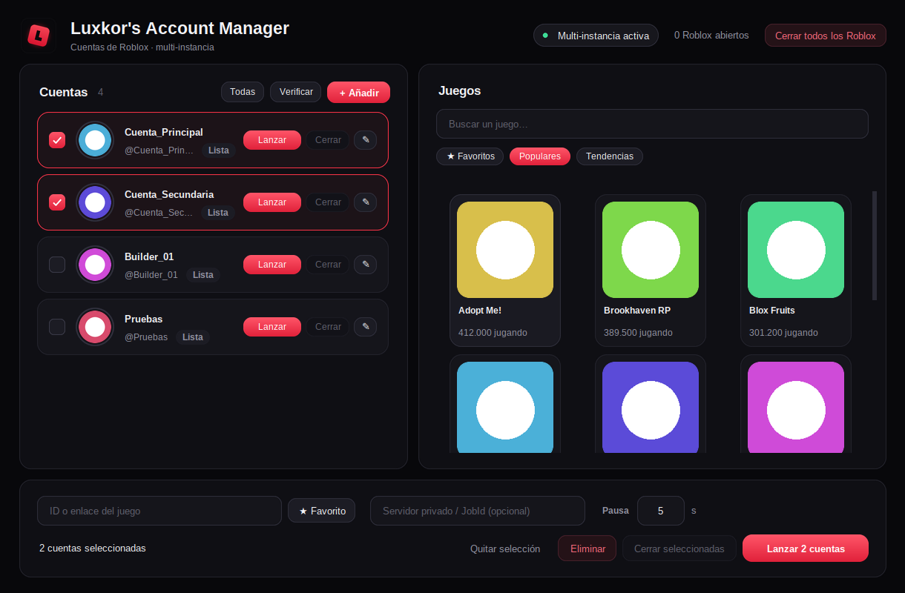

# Luxkor's Account Manager

Gestor de cuentas de Roblox para Windows: guarda varias cuentas, elige un juego de la lista y ábrelas
a la vez en varias instancias del cliente. Aplicación de escritorio (Tkinter), sin navegador ni servidor local.



> La captura usa cuentas y juegos de ejemplo.

## Qué hace

- **Varias cuentas, varias instancias:** lanza el mismo juego con varias cuentas a la vez (multi-instancia).
- **Tres formas de añadir cuentas:**
  - **Cookie** `.ROBLOSECURITY` (también acepta líneas `usuario:contraseña:cookie` y archivos `.txt`).
  - **Navegador:** abre una ventana limpia de Edge/Chrome, inicias sesión (con captcha y 2FA) y la cuenta se añade sola.
  - **Código rápido** (Quick Log In): escribes un código en un dispositivo donde ya tienes la sesión abierta.
- **Lista de juegos integrada:** categorías, buscador, favoritos y miniaturas. Pulsas un juego y lo lanzas.
- **Cookies cifradas** con DPAPI de Windows (ligadas a tu usuario) y nunca mostradas en la interfaz.
- **Eliminar con seguridad:** al borrar una cuenta puedes cerrar también su sesión en Roblox para que la cookie guardada deje de servir.

## Descargar

Descarga `LuxkorAccountManager.exe` y `LuxkorAccountManager.exe.sha256` desde [**Releases**](../../releases). El ejecutable es autónomo: no necesita instalación ni Python.

Cada versión se compila automáticamente en GitHub Actions. Para comprobar que el archivo es el oficial:

```powershell
$expected = (Get-Content .\LuxkorAccountManager.exe.sha256).Split()[0]
$actual = (Get-FileHash .\LuxkorAccountManager.exe -Algorithm SHA256).Hash
if ($actual -ne $expected) { throw "El SHA-256 no coincide" }
```

Windows SmartScreen puede avisar porque el programa no está firmado digitalmente: «Más información» → «Ejecutar de todas formas».
Si prefieres no fiarte de un `.exe`, compílalo tú mismo (abajo).

## Ejecutar desde el código

Requiere Windows, Python 3.10+ y Pillow:

```powershell
pip install -r requirements.txt
python roblox_manager.py
```

## Compilar el `.exe`

Instala las dependencias de compilación y ejecuta:

```powershell
pip install -r requirements.txt -r requirements-dev.txt
pyinstaller --onefile --noconsole --clean --exclude-module numpy --add-data "assets/star.png;assets" --icon assets/icon.ico --name LuxkorAccountManager roblox_manager.py
```

El resultado queda en `dist/LuxkorAccountManager.exe`. Los datos del usuario se guardan en `%APPDATA%\RobloxManager`, no junto al `.exe`.

## Seguridad

Una cookie `.ROBLOSECURITY` da acceso a la cuenta **sin contraseña ni 2FA**, así que se trata como un secreto.
Resumen de lo que hace y no hace el programa en [SECURITY.md](SECURITY.md), incluido cómo reportar una vulnerabilidad.

## Pruebas

```powershell
pip install -r requirements.txt -r requirements-dev.txt
python -m unittest discover -s tests -v
```

## Aviso

Proyecto personal y no oficial; no está afiliado a Roblox Corporation. «Roblox» es marca de su propietario.
Usa el programa solo con cuentas tuyas y bajo tu responsabilidad: revisa los Términos de Uso de Roblox, que pueden
cambiar. Los servicios no documentados que usa (listas de juegos, código rápido) pueden cambiar o dejar de funcionar sin aviso.

## Licencia

[MIT](LICENSE)
